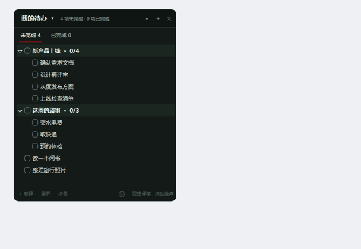

# 待办清单 TodoWidget

贴在桌面上的小待办工具。Python + tkinter，单文件夹、不联网。

<p align="center">
  
</p>

---

## 安装

**方式一（推荐）**：直接双击 `待办清单.exe`，不需要装任何东西。

**方式二**：用源码跑，需要 Python 3.8+：

```bash
py -3 -m pip install pystray pillow
pyw -3 todo.py
```

启动后窗口出现在屏幕右上角，右下角托盘有图标。

---

## 怎么用

### 加任务

- 点左下角 `＋ 新建`，或按 `Insert`
- 想加子任务：选中父任务后按 `Ctrl+Insert`
- 新任务会自动选中名字，直接打字即可；不输入就点别处，这条自动消失

### 勾选

- **点任务左边的方框** 就是勾选 / 取消
- 勾组会连带所有子项；子项全勾上，组自己也会打勾
- 完成的任务文字加删除线变暗，并出现在「已完成」页签

### 修改和删除

| 想做什么 | 怎么做 |
|---|---|
| 改名 | `F2`，或右键 → 重命名 |
| 删除 | `Delete`，或右键 → 删除 |
| 上移 / 下移 | 右键 → 上移 / 下移 |

### 写便签

**双击任务文字** 打开便签。已经有内容的便签默认是**预览**态，点右上角「编辑」才进入编辑。

记什么都行：

```
# 标题
- 无序列表
1. 有序列表
**加粗**   `代码`   > 引用
https://网址自动变链接
```

- 敲 `- xxx` 回车会自动续 `- `，`1. xxx` 回车自动变 `2. `
- 网址点一下就打开，用系统默认浏览器
- **拖右下角**可以改便签宽高，位置和大小都会记住
- 关掉便签：点右上角 `✕`、按 `Esc`、或点主窗口任意位置
- 有便签的任务，行尾会出现 `✎`

### 便签里放图片

- 点便签右上角 🖼 选一张本地图片
- 或者直接 **Ctrl+V** 粘贴剪贴板里的截图
- 图片会存进 `note_images/` 文件夹，并在预览里按宽度自动缩放显示
- 想删掉图片：切到编辑态，把那一行 `` 删掉即可

### 把便签钉在最前面

便签右上角有个 📌：

- 点一下 → **钉在最前面**：它会一直浮在别的窗口上面，点主窗口、点别的任务也不会消失
- 位置随便拖，会记住；关掉软件重开，钉住的便签会自动摆回原位
- 再点一次 📌 → 取消钉住，恢复成普通弹窗（点别处就收起来）
- 可以同时钉好几张便签

### 钉住重要的

- 每行最右边有个图钉位，**点一下钉住，再点取消**
- 钉住的条目固定排在同一层最前面（手动排序、按时间排序都一样）
- 右键菜单里也有「钉到最前 / 取消钉住」

### 调整顺序

**手动模式（默认）**：

- 按住一行上下拖：拖到行的**上/下边缘**是插到它前面/后面
- 拖到某个**组的中间**（行变琥珀色）就是收进这个组
- 拖动时会有一张小卡片跟着鼠标

**按时间模式**：在 `⚙ 设置 → 排序` 里切换。

- 未完成页按**创建时间**从早到晚排
- 已完成页按**完成时间**从新到旧排
- 中间会出现日期隔板（`今天 · 11-05`、`昨天 · 11-04`…），一眼看出是哪天建/哪天完成的
- 这个模式下**不能拖动**（顺序由时间决定），右键的上移/下移也会变灰

### 多个清单

点左上角的**清单名**（如 `我的待办 ▾`）打开菜单：

- 点清单名即可切换
- `新建清单…` / `重命名` / `删除`（至少保留一份）
- 每份清单会自动分配一个**颜色**（名字前面的小圆点），菜单里也能一眼分清

每份清单的任务、便签、顺序各自独立。

### 换配色和质感

点右下角 `⚙`：

- **配色**：深色 / 浅色 / 墨绿 / 暖沙 四套主题
- **强调色**：点开取色器自定义（勾选框、进度条、选中色都会跟着变）
- **排序**：手动拖动 / 按时间（按时间会显示日期隔板且不能拖动）
- **质感**：
  - **纯色**：现在的样子，干净利落
  - **纸质**：整套换成暖米色纸张配色，配便签的米黄纸很搭
  - **磨砂**：调用 Windows 亚克力模糊，窗口半透明带磨砂感（Win10 1803 以上支持，旧系统会自动退回纯色）

### 收起和开机自启

| 想要 | 怎么做 |
|---|---|
| 只留一条横杠 | 点右上角 `▴`，再点 `▾` 展开 |
| 隐藏到托盘 | 点右上角 `✕`，或双击托盘图标 |
| 开机自启 | 双击 `开机自启-开启.bat`（取消就双击另一个） |
| 贴桌面 / 总在最前 | 右键托盘图标切换 |
| 退出 | 右键托盘图标 → 退出 |

---

## 快捷键

| 键 | 作用 |
|---|---|
| `Insert` | 新建任务 |
| `Ctrl+Insert` | 新建子任务 |
| `空格` | 勾选当前行 |
| `F2` | 改名 |
| `Delete` | 删除 |
| `Esc` | 关闭便签 |

---

## 文件

| 文件 | 说明 |
|---|---|
| `待办清单.exe` | 打包好的程序，双击即用，不需要 Python |
| `todo.py` | 源码入口 |
| `todowidget/` | 源码包（界面、数据、配色等分模块） |
| `todo_data.db` | 你的任务数据（SQLite，自动生成，建议备份） |
| `todo_config.json` | 界面配置（主题、位置、置顶、排序方式，自动生成） |
| `启动待办.bat` | 有 exe 就启动 exe，否则用源码启动 |
| `开机自启-开启.bat` / `开机自启-关闭.bat` | 开机自启开关 |

备份或换电脑：把整个文件夹复制走即可，数据都在里面。

> 数据存在 `todo_data.db`（SQLite），可以用任意 SQLite 工具打开查看；
> 如果只有老版本留下的 `todo_data.json`，首次启动会自动导入并生成数据库。

> 改完源码想重新打包：`py -3 -m PyInstaller --noconfirm --onefile --windowed --icon icon.ico --name "待办清单" todo.py`

---

## 自检

```bash
py -3 todo.py --selftest
```

用临时数据跑一遍核心操作，不会动你的任务。
