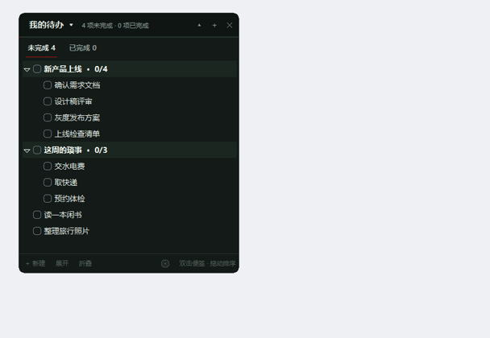

# 待办清单 TodoWidget

贴在桌面上的小待办工具。Python + tkinter，单文件夹、不联网。

<p align="center">
  
</p>

---

## 安装

**方式一（推荐）**：直接双击 `待办清单.exe`，不需要装任何东西。

**方式二**：用源码跑，需要 Python 3.8+：

```bash
py -3 -m pip install pystray pillow
pyw -3 todo.py
```

启动后窗口出现在屏幕右上角，右下角托盘有图标。

---

## 怎么用

### 加任务

- 点左下角 `＋ 新建`，或按 `Insert`
- 想加子任务：选中父任务后按 `Ctrl+Insert`
- 新任务会自动选中名字，直接打字即可；不输入就点别处，这条自动消失

### 勾选

- **点任务左边的方框** 就是勾选 / 取消
- 勾组会连带所有子项；子项全勾上，组自己也会打勾
- 完成的任务文字加删除线变暗，并出现在「已完成」页签

### 修改和删除

| 想做什么 | 怎么做 |
|---|---|
| 改名 | `F2`，或右键 → 重命名 |
| 删除 | `Delete`，或右键 → 删除 |
| 上移 / 下移 | 右键 → 上移 / 下移 |

### 写便签

**双击任务文字** 打开便签。已经有内容的便签默认是**预览**态，点右上角「编辑」才进入编辑。

记什么都行：

```
# 标题
- 无序列表
1. 有序列表
**加粗**   `代码`   > 引用
https://网址自动变链接
```

- 敲 `- xxx` 回车会自动续 `- `，`1. xxx` 回车自动变 `2. `
- 网址点一下就打开，用系统默认浏览器；预览里太长的网址会显示成 `https://docs.fscut.com/pages/vie…567890123`，点开仍然是完整地址
- **拖右下角**可以改便签宽高，位置和大小都会记住
- 关掉便签：点右上角 `✕`、按 `Esc`、或点主窗口任意位置
- 有便签的任务，行尾会出现 `✎`

### 便签里放图片

- 点便签右上角 🖼 选一张本地图片
- 或者直接 **Ctrl+V** 粘贴剪贴板里的截图
- 图片会存进 `note_images/` 文件夹，并在预览里按宽度自动缩放显示
- **点一下图片**（预览态）或**双击**（编辑态）可以放大查看
- 放大窗口外面有一圈深色外框，按住图片或外框都能拖动位置；右上角 `✕`、按 `Esc`、或点到别的窗口都会关闭
- 想删掉图片：切到编辑态，把那一行 `` 删掉即可

### 把便签钉在最前面

便签右上角有个 📌：

- 点一下 → **钉在最前面**：它会一直浮在别的窗口上面，点主窗口、点别的任务也不会消失
- 位置随便拖，会记住；钉住只影响"会不会被点走"，**关掉软件后便签不会自动弹出**
- 再点一次 📌 → 取消钉住，恢复成普通弹窗（点别处就收起来）
- 可以同时钉好几张便签

### 钉住重要的

- 每行最右边有个图钉位，**点一下钉住，再点取消**
- 钉住的条目固定排在同一层最前面（手动排序、按时间排序都一样）
- 右键菜单里也有「钉到最前 / 取消钉住」

### 调整顺序

**手动模式（默认）**：

- 按住一行上下拖：拖到行的**上/下边缘**是插到它前面/后面
- 拖到某个**组的中间**（行变琥珀色）就是收进这个组
- 拖动时会有一张小卡片跟着鼠标

**按时间模式**：在 `⚙ 设置 → 排序` 里切换。

- 未完成页按**创建时间**从早到晚排
- 已完成为**按完成日期收纳**的可折叠分组：`今天 · 11-06 · 3`、`昨天 · 11-05 · 2`、`2026-11-01 · 4`，点前面的小三角收起/展开，底下「折叠/展开」按钮会一次全收或全开
- 中间会出现日期隔板（`今天 · 11-05`、`昨天 · 11-04`…），一眼看出是哪天建/哪天完成的
- 这个模式下**不能拖动**（顺序由时间决定），右键的上移/下移也会变灰

### 多个清单

点左上角的**清单名**（如 `我的待办 ▾`）打开菜单：

- 点清单名即可切换
- `新建清单…` / `重命名` / `删除`（至少保留一份）
- 每份清单会自动分配一个**颜色**（名字前面的小圆点），菜单里也能一眼分清

每份清单的任务、便签、顺序各自独立。

### 换配色（现在没有“质感”选项了）

点右下角 `⚙`，或右键托盘图标 → `设置…`，会打开一个专门的设置窗口（左边分类，右边选项）。
窗口是模态的：没关掉之前点主界面不会有反应；每次打开都出现在主窗口所在那块屏幕的正中间，顶栏可以拖动。

- **外观**
  - **配色**：13 套纯色现成的（深色 / 浅色 / 墨绿 / 暖沙 / Nord / Dracula / Solarized 深、浅 / 东京夜 / Gruvbox / Catppuccin / GitHub 亮 / Monokai）+ 8 套渐变（深海 / 日落 / 晨雾 / 午夜蓝 / 樱花 / 极光 / 琥珀 / 暮色），点色块直接换
  - **自定义配色**：三种模式，三选一
    - **纯色**：选底色 + 强调色；文字颜色也可以自己选，不选就按底色深浅自动配
    - **渐变**：起始色 + 结束色 + 方向（竖向 / 横向 / 斜向），透明度可调
    - **图片**：选一张图片当**整窗皮肤**（类似老 QQ 换肤）—— 底图铺满整窗、文字不透明；
      在编辑框的预览里**拖动**可以选露哪一块，还能调**缩放**和**透明度**（往底色里混多少）
    - 保存后跟内置配色一样能随时切换；右键自定义色块可以编辑、复制一份或删除
    - 右键任意内置配色（含渐变）只有「复制为自定义配色…」——自带的可以复制，删不掉
  - **强调色**：点开取色器自定义（勾选框、进度条、选中色都会跟着变）
  - **统计**：顶栏那一行「N 项未完成」显示还是隐藏
- **排序**：手动拖动 / 按时间（按时间会显示日期隔板且不能拖动）
- **窗口**：总在最前、自由调节 / 锁定宽高
- **关于与更新**：看当前版本，点「检查更新」从 GitHub 下载最新打包版本（会在退出后自动换上新 exe 并重启）

渐变 / 图片底图是“真透明”的做法：主窗口的背景用色键抠成透明，后面单独放一块显示底图的窗口，
**文字保持不透明**，列表、页签、底栏都能看到底图。「透明度」控制的是底图往底色里混多少，0% 就是原图满色。
底图空白处的点击会转发给主窗口对应的控件，所以滚动、选中、拖动排序都照常。

### 改窗口大小

- 展开状态下，**拖右下角的三道小斜纹**就能自由改宽和高（拖动时按帧节流，不会一直狂重画）
- 窗口拖窄了，底栏的提示文字和顶栏统计会自动收起，不会把折叠、齿轮这些按钮挤掉
- 不想让窗口被拖动改大小：`设置 → 窗口 → 锁定`，或右键顶栏 / 托盘图标勾上「锁定窗口大小」
- 收起成横条后是固定的小尺寸，不能拉宽高

### 收起和开机自启

| 想要 | 怎么做 |
|---|---|
| 打开设置 | 点右下角 `⚙`，或右键托盘图标 → `设置…` |
| 只留一条窄横条 | 点右上角 `▴`，再点 `▾` 展开（收起时标题固定显示「待办清单」，不显示统计） |
| 隐藏到托盘 | 点右上角 `✕`，或双击托盘图标 |
| 开机自启 | 双击 `开机自启-开启.bat`（取消就双击另一个） |
| 总在最前 | 设置 → 窗口，或右键托盘图标 |
| 退出 | 右键托盘图标 → 退出 |

收起和展开都带过渡动画：窗口会顺着边缘卷起来/放出来，标题淡出淡入地切换（清单名 ↔「待办清单」），不会一下跳过去。

---

## 快捷键

| 键 | 作用 |
|---|---|
| `Insert` | 新建任务 |
| `Ctrl+Insert` | 新建子任务 |
| `空格` | 勾选当前行 |
| `F2` | 改名 |
| `Delete` | 删除 |
| `Esc` | 关闭便签 |

---

## 文件

| 文件 | 说明 |
|---|---|
| `待办清单.exe` | 打包好的程序，双击即用，不需要 Python |
| `todo.py` | 源码入口 |
| `todowidget/` | 源码包（界面、数据、配色等分模块） |
| `version.txt` | 最新版本号，更新按钮拿它跟自己比 |
| `todo_data.db` | 你的任务数据（SQLite，自动生成，建议备份） |
| `todo_config.json` | 界面配置（主题、位置、置顶、排序方式，自动生成） |
| `启动待办.bat` | 有 exe 就启动 exe，否则用源码启动 |
| `开机自启-开启.bat` / `开机自启-关闭.bat` | 开机自启开关 |

备份或换电脑：把整个文件夹复制走即可，数据都在里面。

> 数据存在 `todo_data.db`（SQLite），可以用任意 SQLite 工具打开查看；
> 如果只有老版本留下的 `todo_data.json`，首次启动会自动导入并生成数据库。

> 改完源码想重新打包：`py -3 -m PyInstaller --noconfirm --onefile --windowed --icon icon.ico --name "待办清单" todo.py`
>
> 发新版时记得同时改 `todowidget/version.py` 和根目录的 `version.txt`（两处写一样的版本号），
> 再把新的 `待办清单.exe` 一起推到 GitHub；「检查更新」就是比对 `version.txt` 和本机的版本号。
> 没推上去的话，按钮会提示`服务器上还没有版本文件`。

---

## 自检

```bash
py -3 todo.py --selftest
```

用临时数据跑一遍核心操作，不会动你的任务。
